<!-- BANNER: nmap-style scan, generated by scripts/banner.py -->
<picture>
  <source media="(prefers-color-scheme: dark)"  srcset="assets/banner-dark.svg">
  <source media="(prefers-color-scheme: light)" srcset="assets/banner-light.svg">
  
</picture>

 

<!-- TAGLINE: animated typing -->

 

<!-- SOCIALS -->
&nbsp;&nbsp;
<!-- Uncomment and put your real profile URLs:
&nbsp;&nbsp;
&nbsp;&nbsp;
-->

 

---

## `$ whoami`

Hi, I'm **Mario**, a Systems and Communications Engineering student at UAEMéx, based in Mexico 🇲🇽.
I like security best when I get to build the thing and then try to break it, so my
learning goes both ways: offensive security on Hack The Box, and real infrastructure on AWS.

- 🎯 Looking for **trainee or junior roles** in cybersecurity (SOC, vulnerability management, cloud security), cloud, or data.
- 🔐 **Hack The Box Academy:** footprinting, vulnerability assessment, shells and payloads, pivoting.
- ☁️ **AWS:** designed and deployed a production-style, zero-trust setup on my own.
- 📊 **Python, SQL and ML:** ETL pipelines, churn analysis, dashboards.
- 🏅 **Mexican Informatics Olympiad**, 2019.

## `$ cat stack.txt`

---

## 🔒 Featured build: BDS SecureVault

**Self-hosted password manager on AWS.** Zero-trust Vaultwarden deployment for 50–100 users.
Designed, built and shipped solo, end to end, in about 4.5 hours against an original 12-week scope.

- **Zero public inbound ports.** Cloudflare Tunnel only, all traffic outbound.
- **RDS PostgreSQL** with `sslmode=verify-full` against the AWS CA bundle.
- **Encrypted nightly backups** to S3 with a 30-day lifecycle rule.
- **AWS Secrets Manager.** No credential, not even a hash, ever touches git.
- **Least-privilege IAM.** The EC2 role can read exactly one secret.

**[Read the repo →](https://github.com/Diablo999-hub/bds-securevault)**

---

## `$ ./signals`

<table>
<tr>
<td width="50%" align="center" valign="middle">

<!-- Edit assets/skills.json and push: the workflow redraws it -->
<picture>
  <source media="(prefers-color-scheme: dark)"  srcset="assets/radar-dark.svg">
  <source media="(prefers-color-scheme: light)" srcset="assets/radar-light.svg">
  
</picture>

</td>
<td width="50%" align="center" valign="middle">

<!-- Edit assets/toolkit.json and push: the workflow redraws it -->
<picture>
  <source media="(prefers-color-scheme: dark)"  srcset="assets/radar-toolkit-dark.svg">
  <source media="(prefers-color-scheme: light)" srcset="assets/radar-toolkit-light.svg">
  
</picture>

</td>
</tr>
</table>

Self-rated, and I update it as I learn.

---

## `$ ls ~/projects`

| Project | Stack | Link |
| --- | --- | --- |
| 🔒 BDS SecureVault: password manager on AWS | AWS · Docker · Cloudflare | [repo](https://github.com/Diablo999-hub/bds-securevault) |
| 📊 TelecomX: customer churn analysis | Python · Pandas · EDA | [repo](https://github.com/Diablo999-hub/TelecomX_alura) |
| ⚙️ Alura Store: ETL and visualization | ETL · Matplotlib · Seaborn | [repo](https://github.com/Diablo999-hub/Challenge-Alura-Store) |
| 🐍 10 Python projects: utilities | Python · CLI | [repo](https://github.com/Diablo999-hub/10-Proyects-Python) |
| 🎮 Coin Game | Python · Pygame | [repo](https://github.com/Diablo999-hub/Juego-de-Monedas-Pygame-) |
| 🔐 WordPress XML-RPC exploitation research | Security | [article](https://www.alpra-tdm.com/blog/explotaci%C3%B3n-a-gestores-de-contenido) |

---

## `$ cat certs.log`

- **OCI Foundations Associate**, Oracle (Nov 2025)
- **ONE Tech Foundation, Data Science**, Alura Latam (2025): Python, ML, ETL, statistics
- **Oracle Next Education**, cloud fundamentals (2024)
- **Hack The Box Academy** training modules (not a certification): footprinting, vulnerability assessment, attacking common services, shells and payloads, pivoting
- **hack4u.io** courses: intro to hacking, offensive Python, Linux
- **codigofacilito.com** courses: data analysis with Python, Pygame

---

## `$ netstat --numbers`

<!-- Generated by scripts/cards.py into this repo, refreshed daily by the workflow.
     No third-party stats services, so nothing here goes down with someone else's server. -->
<picture>
  <source media="(prefers-color-scheme: dark)"  srcset="assets/card-stats-dark.svg">
  <source media="(prefers-color-scheme: light)" srcset="assets/card-stats-light.svg">
  
</picture>

 

<picture>
  <source media="(prefers-color-scheme: dark)"  srcset="assets/card-langs-dark.svg">
  <source media="(prefers-color-scheme: light)" srcset="assets/card-langs-light.svg">
  
</picture>

---

`$ exit` · say hi at <a href="https://diablo999-hub.github.io">diablo999-hub.github.io</a>

