<picture>
  <source media="(prefers-color-scheme: dark)"  srcset="assets/banner-dark.svg">
  <source media="(prefers-color-scheme: light)" srcset="assets/banner-light.svg">
  
</picture>

 

&nbsp;

---

## About

I'm a Systems and Communications Engineering student at UAEMéx, based in Mexico.
I like security best when I get to build the thing and then try to break it, so my
learning goes both ways: offensive security on Hack The Box, and real infrastructure on AWS.

I'm looking for **trainee or junior roles** in cybersecurity (SOC, vulnerability
management, cloud security), cloud, or data.

- 🔐 Hack The Box Academy: footprinting, vulnerability assessment, shells and payloads, pivoting
- ☁️ AWS: designed and deployed a production-style, zero-trust setup on my own
- 📊 Python, SQL and ML: ETL pipelines, churn analysis, dashboards
- 🏅 Mexican Informatics Olympiad, 2019

---

## Featured build

### 🔒 BDS SecureVault: self-hosted password manager on AWS

Zero-trust Vaultwarden deployment for 50–100 users. Designed, built and shipped solo,
end to end, in about 4.5 hours against an original 12-week scope.

- **Zero public inbound ports.** Cloudflare Tunnel only, all traffic outbound.
- **RDS PostgreSQL** with `sslmode=verify-full` against the AWS CA bundle.
- **Encrypted nightly backups** to S3 with a 30-day lifecycle rule.
- **AWS Secrets Manager.** No credential, not even a hash, ever touches git.
- **Least-privilege IAM.** The EC2 role can read exactly one secret.

**[Read the repo →](https://github.com/Diablo999-hub/bds-securevault)**

---

## Skills

<picture>
  <source media="(prefers-color-scheme: dark)"  srcset="assets/radar-dark.svg">
  <source media="(prefers-color-scheme: light)" srcset="assets/radar-light.svg">
  
</picture>

Self-rated, and I update it as I learn.

**Languages:** Python · SQL · Java · JavaScript · C · C++
**Data:** Pandas · NumPy · scikit-learn · Matplotlib · Seaborn
**Cloud and infra:** AWS (EC2, RDS, S3, IAM, Secrets Manager, SES) · Docker · Oracle Cloud · Cloudflare Tunnel · Git
**Security:** Nmap · Metasploit · SQL injection · pivoting and tunneling · Linux

---

## Projects

| Project | Stack | Link |
| --- | --- | --- |
| 📊 TelecomX: customer churn analysis | Python · Pandas · EDA | [repo](https://github.com/Diablo999-hub/TelecomX_alura) |
| ⚙️ Alura Store: ETL and visualization | ETL · Matplotlib · Seaborn | [repo](https://github.com/Diablo999-hub/Challenge-Alura-Store) |
| 🐍 10 Python projects: utilities | Python · CLI | [repo](https://github.com/Diablo999-hub/10-Proyects-Python) |
| 🎮 Coin Game | Python · Pygame | [repo](https://github.com/Diablo999-hub/Juego-de-Monedas-Pygame-) |
| 🔐 WordPress XML-RPC exploitation research | Security | [article](https://www.alpra-tdm.com/blog/explotaci%C3%B3n-a-gestores-de-contenido) |

---

## Certifications and training

- **OCI Foundations Associate**, Oracle (Nov 2025)
- **ONE Tech Foundation, Data Science**, Alura Latam (2025): Python, ML, ETL, statistics
- **Oracle Next Education**, cloud fundamentals (2024)
- **Hack The Box Academy** training modules (not a certification): footprinting, vulnerability assessment, attacking common services, shells and payloads, pivoting
- **hack4u.io** courses: intro to hacking, offensive Python, Linux
- **codigofacilito.com** courses: data analysis with Python, Pygame

---

Say hi at <a href="https://diablo999-hub.github.io">diablo999-hub.github.io</a>

